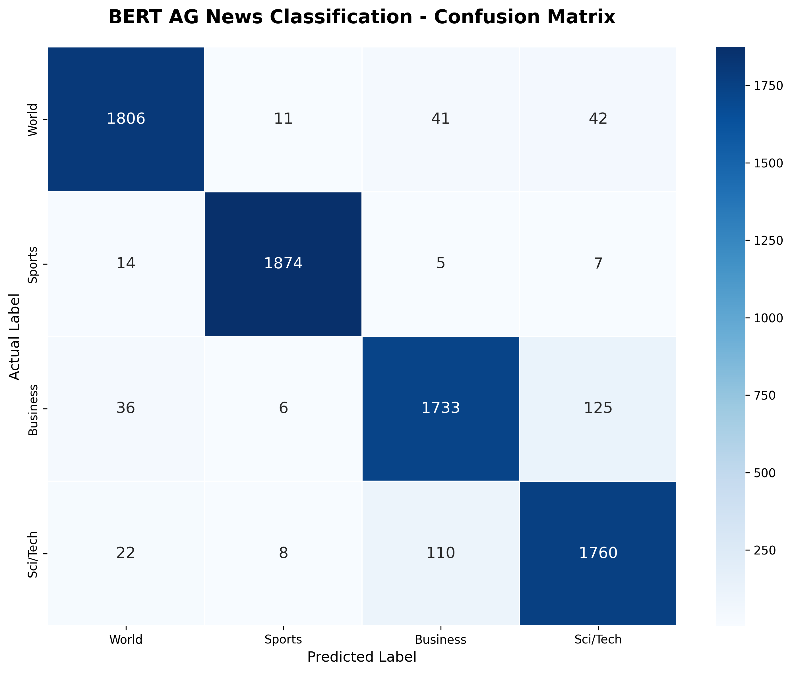

# 📰 BERT-Based News Classification

A fine-tuned BERT model that automatically classifies news articles into four categories: **World, Sports, Business, and Sci/Tech**.

<p align="center">

[](https://huggingface.co/sushil9876/bert-ag-news-classifier)
[](https://huggingface.co/spaces/sushil9876/bert-ag-news-demo)
[](https://www.python.org/)
[](https://huggingface.co/docs/transformers)

</p>

## 🚀 Live Demo

Try the deployed application:

**[Open BERT News Classifier Demo](https://huggingface.co/spaces/sushil9876/bert-ag-news-demo)**

Enter a news article and the application predicts its category along with confidence probabilities.

## 📌 Project Overview

This project focuses on building an NLP-based news classification system using a fine-tuned **BERT (Bidirectional Encoder Representations from Transformers)** model.

The model understands contextual relationships between words and predicts the most appropriate category for a given news article.

### Supported Categories

| Category    | Description                                     |
| ----------- | ----------------------------------------------- |
| 🌍 World    | International news, politics, and global events |
| 🏀 Sports   | Sports events, teams, and competitions          |
| 💼 Business | Markets, finance, and companies                 |
| 🔬 Sci/Tech | Science, technology, and innovation             |

## 🧠 Model Information

| Component               | Details                                    |
| ----------------------- | ------------------------------------------ |
| Base Model              | `bert-base-uncased`                        |
| Architecture            | BERT Sequence Classification               |
| Task                    | Multi-class Text Classification            |
| Number of Classes       | 4                                          |
| Maximum Sequence Length | 256                                        |
| Fine-tuning Epochs      | 3                                          |
| Trainable Layers        | Last 3 BERT layers and classification head |
| Framework               | PyTorch                                    |
| Model Library           | Hugging Face Transformers                  |

The first nine BERT encoder layers were frozen during fine-tuning, while the final three encoder layers and classification head were trained.

## 📚 Dataset

**Dataset:** [AG News](https://huggingface.co/datasets/fancyzhx/ag_news)

The dataset contains news articles belonging to four balanced categories.

| Dataset    |     Samples |
| ---------- | ----------: |
| Training   |     108,000 |
| Validation |      12,000 |
| Testing    |       7,600 |
| **Total**  | **127,600** |

The original training dataset was divided into training and validation subsets. The original test set was kept separate for final evaluation.

## ⚙️ Model Training

The project follows these steps:

1. Load the AG News dataset.
2. Inspect and explore the dataset.
3. Load the pretrained BERT tokenizer.
4. Tokenize the news articles.
5. Prepare training, validation, and test datasets.
6. Load the pretrained BERT sequence classification model.
7. Fine-tune the model using PyTorch and Hugging Face Transformers.
8. Evaluate the model on the unseen test dataset.
9. Save and upload the trained model to Hugging Face Hub.
10. Deploy an interactive Gradio application.

## 📊 Model Performance

The final model achieved **94.38% test accuracy** on 7,600 unseen news articles.

### Overall Evaluation Metrics

| Metric             |      Score |
| ------------------ | ---------: |
| Test Loss          |   0.185984 |
| Accuracy           | **94.38%** |
| Weighted Precision |     94.40% |
| Weighted Recall    |     94.38% |
| Weighted F1-score  |     94.39% |
| Macro F1-score     |     94.39% |

### Classification Report

| Category             |  Precision |     Recall |   F1-score |   Support |
| -------------------- | ---------: | ---------: | ---------: | --------: |
| World                |     0.9617 |     0.9505 |     0.9561 |     1,900 |
| Sports               |     0.9868 |     0.9863 |     0.9866 |     1,900 |
| Business             |     0.9174 |     0.9121 |     0.9148 |     1,900 |
| Sci/Tech             |     0.9100 |     0.9263 |     0.9181 |     1,900 |
| **Accuracy**         |            |            | **0.9438** | **7,600** |
| **Macro Average**    | **0.9440** | **0.9438** | **0.9439** | **7,600** |
| **Weighted Average** | **0.9440** | **0.9438** | **0.9439** | **7,600** |

## 📈 Visualizations

### Confusion Matrix

The confusion matrix shows how the model's predictions compare with the actual news categories.



## 🛠️ Technology Stack

- **Python** – Programming language
- **PyTorch** – Deep learning framework
- **Hugging Face Transformers** – BERT model and fine-tuning
- **Hugging Face Datasets** – Dataset loading and preprocessing
- **Scikit-learn** – Evaluation metrics
- **Matplotlib & Seaborn** – Data visualization
- **Gradio** – Interactive web application
- **Hugging Face Hub & Spaces** – Model hosting and deployment

## 📂 Project Structure

```text
bert-ag-news-classification/
│
├── README.md
├── requirements.txt
├── .gitignore
├── app.py
│
├── notebooks/
│   └── bert_ag_news_finetuning.ipynb
│
├── plots/
│   └── bert_ag_news_confusion_matrix.png
│
└── src/
    └── predict.py
```

## 💻 Run Locally

### 1. Clone the repository

```bash
git clone https://github.com/YOUR_USERNAME/bert-ag-news-classification.git
cd bert-ag-news-classification
```

### 2. Create a virtual environment

```bash
python -m venv .venv
```

Activate it:

**macOS/Linux**

```bash
source .venv/bin/activate
```

**Windows**

```bash
.venv\Scripts\activate
```

### 3. Install dependencies

```bash
pip install -r requirements.txt
```

### 4. Launch the application

```bash
python app.py
```

Open the local Gradio URL displayed in the terminal.

## 🤗 Pretrained and Fine-tuned Model

The fine-tuned model and tokenizer are hosted on Hugging Face Hub.

**[View Model Repository](https://huggingface.co/sushil9876/bert-ag-news-classifier)**

## 🌐 Deployment

The interactive application is deployed using Hugging Face Spaces with Gradio.

**[Launch Live Application](https://huggingface.co/spaces/sushil9876/bert-ag-news-demo)**

## 🔮 Future Improvements

- Experiment with other transformer architectures.
- Improve classification performance.
- Add batch news classification.
- Add news article summarization.
- Build an API for integration with other applications.

## 👨‍💻 Author

**Sushil Kumar Sahoo**

Delhi Technological University

---

⭐ If you find this project useful, consider giving the repository a star!
